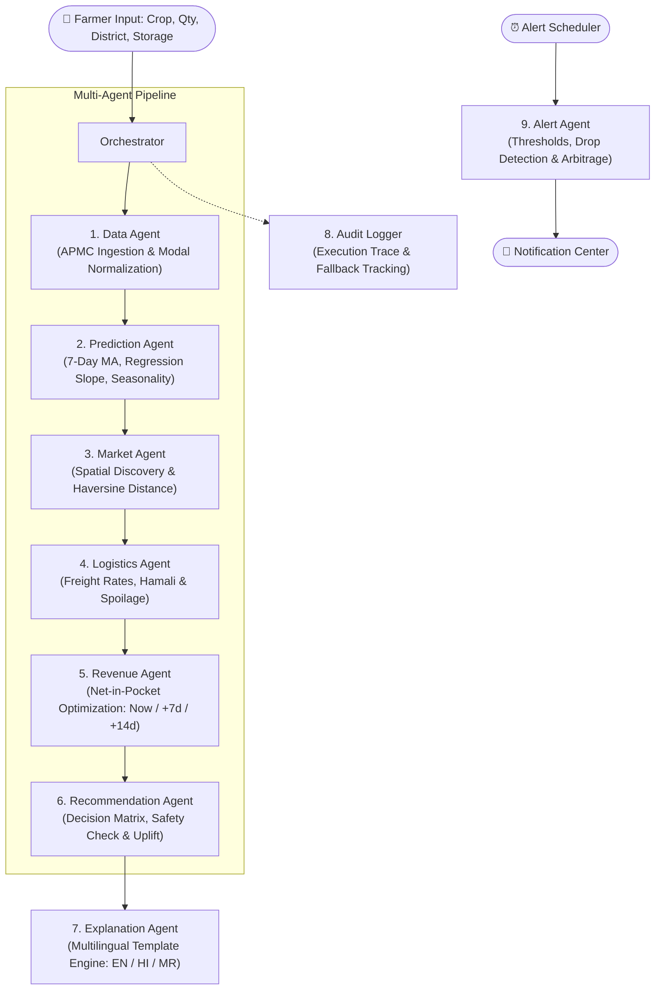
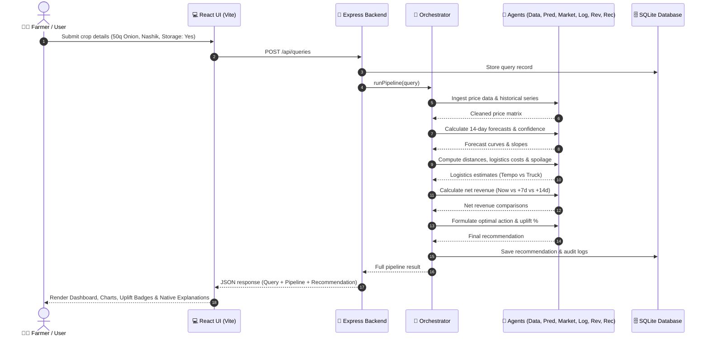
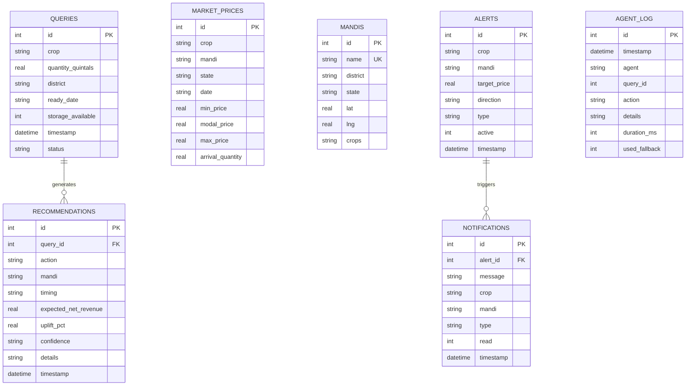

# 🌾 AgriPrice AI

> **AI-Based Smart Agriculture Market Price Prediction & Selling Assistant**  
> *Empowering farmers with data-driven price forecasting, multi-mandi arbitrage analysis, logistics cost optimization, and transparent multilingual selling recommendations.*

---

[](https://react.dev/)
[](https://vitejs.dev/)
[](https://nodejs.org/)
[](https://expressjs.com/)
[](https://sqlite.org/)
[](#-multi-agent-system-architecture)
[](#-multilingual-explanation-engine)
[](LICENSE)

---

## 📌 Table of Contents

- [Overview](#-overview)
- [The Problem & The Solution](#-the-problem--the-solution)
- [Multi-Agent System Architecture](#-multi-agent-system-architecture)
- [Key Features](#-key-features)
- [System Architecture & Data Flow](#-system-architecture--data-flow)
- [Tech Stack](#-tech-stack)
- [Database Schema](#-database-schema)
- [API Reference](#-api-reference)
- [Installation & Quick Start](#-installation--quick-start)
- [Production Deployment Guide](#-production-deployment-guide)
- [Hero Demo Scenario](#-hero-demo-scenario)
- [Configuration & Logistics Engine](#-logistics-engine--configuration)
- [Project Directory Structure](#-project-directory-structure)
- [Troubleshooting & FAQ](#-troubleshooting--faq)
- [Contributing & License](#-contributing--license)

---

## 📖 Overview

**AgriPrice AI** is a decision-support and market intelligence platform designed specifically for Indian agriculture (APMC mandis). When farmers harvest crops such as **Onions, Tomatoes, Grapes, Soybeans, or Wheat**, they face critical selling dilemmas:

1. **Where to sell?** Should they sell at their nearest local mandi or transport produce to a regional hub that offers higher prices?
2. **When to sell?** Should they sell immediately today, hold for 7 days, or store for 14 days?
3. **What is the true net profit?** Higher prices in distant mandis often get consumed by transport freight, loading (*hamali*), mandi commissions, and spoilage losses during transit.

AgriPrice AI solves this via a **deterministic multi-agent architecture** that ingests historical APMC mandi modal price data, predicts 14-day price trajectories with statistical confidence intervals, factors in real transport and spoilage degradation, and calculates the optimal net revenue recommendation with explanations in **English, Hindi, and Marathi**.

---

## 🎯 The Problem & The Solution

```
┌──────────────────────────────────────┐       ┌──────────────────────────────────────┐
│        Traditional Practice          │       │         AgriPrice AI Engine          │
├──────────────────────────────────────┤       ├──────────────────────────────────────┤
│ ❌ Distress sales at nearest mandi    │  ───▶ │ ✅ Multi-mandi price arbitrage       │
│ ❌ Relying on rumor & middlemen      │  ───▶ │ ✅ 14-day statistical price forecast │
│ ❌ Ignoring freight & hamali fees    │  ───▶ │ ✅ Accurate net-in-pocket calculator │
│ ❌ Unquantified transit spoilage risk │  ───▶ │ ✅ Crop-specific decay modeling      │
│ ❌ Complex jargon & language barrier │  ───▶ │ ✅ Plain English, Hindi & Marathi    │
└──────────────────────────────────────┘       └──────────────────────────────────────┘
```

---

## 🤖 Multi-Agent System Architecture

AgriPrice AI employs an autonomous, specialized multi-agent pipeline coordinated by a master **Orchestrator**. Computations are purely deterministic—mathematical formulas and statistical time-series models handle the numbers, preventing any LLM hallucination in financial estimates.



### Specialized Agents

| # | Agent | Role & Methodology |
|---|---|---|
| **1** | **Orchestrator** | Coordinates sequential execution across all agents with graceful fallback mechanisms if any step fails. |
| **2** | **Data Agent** | Normalizes daily APMC market price feeds (Min, Modal, Max, Arrival Quantity) and backfills missing historical points from seed datasets. |
| **3** | **Prediction Agent** | Generates 14-day daily price forecasts combining a **7-day Moving Average (MA)**, **Linear Regression Trend Slope**, and **Day-of-Week Seasonality Factors** with confidence envelopes (`high`, `medium`, `low`). |
| **4** | **Market Agent** | Discovers nearby mandis, computes road/Haversine distances from the farmer's district, and ranks mandis by current and expected prices. |
| **5** | **Logistics Agent** | Computes freight rates using vehicle selection (Tempo ≤ 30q @ ₹3.2/q-km vs. Truck > 30q @ ₹2.2/q-km), handling (*hamali*) fees, and transit decay based on hourly spoilage rates. |
| **6** | **Revenue Agent** | Models gross income minus total deductions (transport, labor, mandi cess, storage costs, transit spoilage) across 3 time horizons: **Sell Today**, **Wait 7 Days**, **Hold 14 Days**. |
| **7** | **Recommendation Agent** | Evaluates net profits against the local baseline mandi, assesses storage viability, and outputs the optimal decision (`action`, `mandi`, `timing`, `expected_net_revenue`, `uplift_pct`). |
| **8** | **Explanation Agent** | Formulates crystal-clear, transparent reasoning and risk alerts in **English**, **Hindi (हिंदी)**, and **Marathi (मराठी)** without hallucinating figures. |
| **9** | **Alert Agent** | Background monitor evaluating farmer price targets, sudden predicted price drops, and emerging mandi arbitrage opportunities every 5 minutes. |
| **10** | **Audit Logger** | Maintains an auditable SQLite log of every agent's execution latency, inputs, actions, and fallback states. |

---

## ✨ Key Features

### 1. 🌾 Farmer Query Intake
Intuitive input for crop selection (**Onion**, **Tomato**, **Grapes**, **Soybean**, **Wheat**), lot size in quintals, origin district, harvest/ready date, and on-farm storage capability.

### 2. 📊 Multi-Mandi Comparison Table
Interactive table comparing nearby mandis showing distance (km), current modal price, 7-day predicted price, estimated transport cost, expected net revenue, and net uplift percentage over the local market.

### 3. 📈 Interactive Price Charts & 14-Day Forecasts
Visual line charts displaying:
- Historical APMC prices (modal, minimum, maximum).
- 14-day forward predictions with confidence intervals.
- Day-of-week demand variance markers.

### 4. ⏱️ Sell Timing Optimizer
Direct side-by-side comparison cards for:
- **Sell Now (Today):** Immediate cashflow, zero holding risk.
- **Wait 7 Days:** Projected price change minus holding/spoilage costs.
- **Hold 14 Days:** Maximum storage window evaluation with storage safety guardrails.

### 5. 🌐 Multilingual Explanation Engine
Farmers can toggle between **English**, **हिंदी (Hindi)**, and **मराठी (Marathi)** to read clear explanations of why an action was suggested, including logistics breakdowns and specific risk factors (e.g., rainfall, perishability).

### 6. 🔔 Smart Alerts & Push Notification Center
Set custom price targets, detect sudden downward market shifts, or catch arbitrage spreads between nearby mandis. Includes an automated background cron scheduler.

### 7. 📋 Last 5 Days APMC Arrival & Price Explorer
Dedicated inspector to explore actual APMC arrivals, modal rates, and daily price spreads across major Maharashtra agricultural hubs.

### 8. 🕵️ Transparent Agent Audit Trail
Live inspection panel displaying the real-time execution steps, latency (ms), and fallback status of every agent in the multi-agent pipeline.

---

## 🏛️ System Architecture & Data Flow



---

## 💻 Tech Stack

### Frontend
- **Framework:** React 19 (Hooks, Context, Modular Components)
- **Bundler & Dev Server:** Vite 8
- **Icons:** Lucide React (`lucide-react`)
- **Styling:** Custom Vanilla CSS Design System with responsive grid, glassmorphic cards, and dynamic state badges.

### Backend
- **Runtime:** Node.js (v18+)
- **Web Framework:** Express.js 4.19
- **Database:** SQLite3 (`sqlite3` driver with promises)
- **Background Jobs:** Built-in Interval Alert Scheduler
- **Process Orchestration:** Node.js `child_process` runner for concurrent multi-tier execution

### Data & Geographic Coverage
- **Core APMC Mandis:** Lasalgaon, Pimpalgaon, Nashik, Pune, Mumbai, Ahmednagar, Solapur, Yeola, Baramati, Sangamner.
- **Supported Crops:** Onion, Tomato, Grapes, Soybean, Wheat.
- **Dataset:** Historical modal price dataset with daily modal, min, max, and arrival volumes.

---

## 🗄️ Database Schema

The SQLite database (`backend/db/agriprice.db`) is automatically initialized using `backend/db/schema.sql`:



---

## 📡 API Reference

Base URL: `http://localhost:5000`

### 1. Farmer Queries & Pipeline Execution
| Endpoint | Method | Description |
|---|---|---|
| `/api/queries` | `POST` | Creates a new farmer query and immediately triggers the full 6-agent analysis pipeline. |
| `/api/queries` | `GET` | Retrieves all submitted queries, sorted by most recent. |
| `/api/queries/:id` | `GET` | Fetches query details along with its latest recommendation. |

#### Request Body (`POST /api/queries`):
```json
{
  "crop": "Onion",
  "quantity_quintals": 50,
  "district": "Nashik",
  "ready_date": "2026-10-02",
  "storage_available": true
}
```

### 2. Market Prices & Forecasting
| Endpoint | Method | Query Parameters | Description |
|---|---|---|---|
| `/api/prices` | `GET` | `crop`, `mandi`, `days` | Historical daily prices (modal, min, max, arrivals). |
| `/api/predict` | `GET` | `crop`, `mandi` | 14-day price prediction with linear slope, MA, and confidence intervals. |
| `/api/markets` | `GET` | `query_id` OR `crop` & `district` | Multi-mandi comparison matrix including transport costs and net returns. |
| `/api/markets/list` | `GET` | - | Lists all registered mandis with lat/lng and supported crops. |
| `/api/cities` | `GET` | - | List of unique mandi cities available in the price dataset. |

### 3. Logistics & Revenue Engine
| Endpoint | Method | Description |
|---|---|---|
| `/api/logistics` | `GET` / `POST` | Computes transport costs, vehicle selection (Tempo vs Truck), handling fees, and spoilage risk. |
| `/api/revenue` | `GET` / `POST` | Models net revenues across `now`, `wait_7d`, and `wait_14d` decision windows. |
| `/api/recommendations/:query_id`| `GET` | Returns stored recommendation and decision metrics for a specific query. |
| `/api/explain/:recommendation_id`| `GET` | Multilingual explanation. Accepts query param `?lang=en` \| `hi` \| `mr`. |

### 4. Smart Alerts & Audit Logs
| Endpoint | Method | Description |
|---|---|---|
| `/api/alerts` | `GET` | Lists all active price and arbitrage alerts. |
| `/api/alerts` | `POST` | Creates a new price target or drop alert. |
| `/api/alerts/:id` | `DELETE` | Removes an alert subscription. |
| `/api/alerts/run` | `POST` | Manually triggers the alert evaluation engine. |
| `/api/notifications` | `GET` | Retrieves unread and recent alert notifications. |
| `/api/notifications/:id/read` | `PATCH` | Marks a specific notification as read. |
| `/api/notifications/clear` | `POST` | Clears all notifications. |
| `/api/agent-log` | `GET` | Fetches audit trail logs (`?query_id=...&limit=50`). |
| `/api/dashboard/last5days` | `GET` | Last 5 days APMC arrival and price metrics (`?city=...&crop=...`). |
| `/api/dashboard/cities` | `GET` | List of available cities with historical records. |
| `/api/health` | `GET` | Service status and health check. |

---

## 🚀 Installation & Quick Start

### Prerequisites
- [Node.js](https://nodejs.org/) version **18.0.0 or higher**
- `npm` package manager (included with Node.js)

### 1. Clone the Repository
```bash
git clone https://github.com/your-username/agriprice-ai.git
cd agriprice-ai
```

### 2. Install All Dependencies
Install backend and frontend dependencies in a single step:
```bash
npm run install:all
```
*(Alternatively, run `npm install` inside both `backend` and `frontend` folders).*

### 3. Launch the Full Application
Start both the Express backend and Vite frontend with one command:
```bash
npm start
```
- **Backend API:** `http://localhost:5000`
- **Frontend Dashboard:** `http://localhost:5173`

> [!TIP]
> To run the backend and frontend in separate terminals during development:
> ```bash
> # Terminal 1 - Backend (with live auto-reload)
> cd backend
> npm run dev
> 
> # Terminal 2 - Frontend
> cd frontend
> npm run dev
> ```

---

## 🚢 Production Deployment Guide

AgriPrice AI supports both **unified monolithic deployment** (Express serving the compiled React frontend + REST APIs from a single service) and **split deployment** (Frontend on Vercel/Netlify, Backend on Render/Railway).

### Method 1: Render.com (Recommended Free/Low-Cost Deployment)

Render allows you to host the entire full-stack app as a single **Web Service**:

1. **Push your code to GitHub / GitLab**.
2. **Log in to [Render Dashboard](https://dashboard.render.com/)** and click **New + > Web Service**.
3. **Connect your repository**.
4. Configure the Web Service settings:
   - **Name:** `agriprice-ai`
   - **Environment:** `Node`
   - **Build Command:**
     ```bash
     npm run build
     ```
   - **Start Command:**
     ```bash
     npm run start:prod
     ```
   - **Environment Variables:**
     - `NODE_ENV`: `production`
     - `PORT`: `5000` *(or leave default, Render sets `$PORT` automatically)*
5. *(Optional for persistence)*: In the Render **Disks** tab, add a Persistent Disk mounted at `/app/backend/db` (size: 1 GB) so SQLite queries and alerts persist across redeployments.
6. Click **Deploy Web Service**. Once built, your app will be live at `https://agriprice-ai.onrender.com`.

---

### Method 2: Railway.app

1. Go to [railway.app](https://railway.app/) and create a **New Project**.
2. Select **Deploy from GitHub repo**.
3. Railway automatically detects `package.json`:
   - Under **Settings > Build Command**, enter:
     ```bash
     npm run build
     ```
   - Under **Settings > Start Command**, enter:
     ```bash
     npm run start:prod
     ```
4. Attach a persistent volume to `backend/db` to retain the SQLite database.
5. In **Networking**, click **Generate Domain** to get your public HTTPS URL.

---

### Method 3: Docker & Docker Compose (VPS / AWS / GCP / DigitalOcean)

The repository includes a multi-stage [Dockerfile](file:///d:/SAMRT%20AGRI/Dockerfile) and [docker-compose.yml](file:///d:/SAMRT%20AGRI/docker-compose.yml).

#### Run with Docker Compose:
```bash
# Build image and run in detached mode with persistent volume
docker compose up -d --build

# View container logs
docker compose logs -f

# Stop application
docker compose down
```

#### Run with Plain Docker:
```bash
# 1. Build the production image
docker build -t agriprice-ai:latest .

# 2. Run container with port mapping and volume mount for SQLite
docker run -d \
  --name agriprice_app \
  -p 5000:5000 \
  -v $(pwd)/backend/db:/app/backend/db \
  agriprice-ai:latest
```
Access the application at `http://your-server-ip:5000`.

---

### Method 4: Split Deployment (Vercel Frontend + Render Backend)

If you prefer hosting the React frontend on Vercel and the Express backend on Render:

1. **Deploy Backend on Render**:
   - Root directory: `backend`
   - Build command: `npm install`
   - Start command: `node server.js`
   - Copy the backend URL (e.g., `https://agriprice-backend.onrender.com`).

2. **Deploy Frontend on Vercel**:
   - Root directory: `frontend`
   - Framework preset: `Vite`
   - Add a `vercel.json` file inside `frontend/` with rewrite rules:
     ```json
     {
       "rewrites": [
         {
           "source": "/api/(.*)",
           "destination": "https://agriprice-backend.onrender.com/api/$1"
         },
         {
           "source": "/(.*)",
           "destination": "/index.html"
         }
       ]
     }
     ```
   - Click **Deploy**.

---

## 🌟 Hero Demo Scenario

The application comes pre-loaded with a demonstration scenario:

- **Farmer Location:** Nashik District, Maharashtra
- **Harvest Lot:** 50 Quintals of **Onion**
- **Storage Facility:** Available on farm
- **Comparison Mandis:**
  - **Nashik Mandi:** Distance ~15 km | Modal Price ~₹1,850/q | Immediate baseline
  - **Lasalgaon Mandi:** Distance ~45 km | Modal Price ~₹2,100/q | Predicted 7d: ~₹2,450/q (Rising)
  - **Pimpalgaon Mandi:** Distance ~32 km | Modal Price ~₹2,020/q | Predicted 7d: ~₹2,280/q

### Expected Pipeline Output:
1. **Decision:** `WAIT_7D` (Wait 7 days to sell).
2. **Recommended Market:** `Lasalgaon Mandi`.
3. **Logistics Deduction:** Transport (~₹4,950 for 50q Truck) + Hamali (~₹1,750) + Spoilage (~0.08%).
4. **Projected Net Uplift:** **+₹20,000 to +₹25,000 net profit gain** compared to selling immediately in Nashik.
5. **Multilingual Explanation:** Instant reasoning available in Marathi, Hindi, and English explaining why holding at Lasalgaon compensates for the extra travel distance.

---

## ⚙️ Logistics Engine & Configuration

All logistics cost parameters, transport speed, and crop spoilage rates are modularly configured in [`backend/config/logisticsRates.json`](file:///d:/SAMRT%20AGRI/backend/config/logisticsRates.json):

```json
{
  "average_speed_kmh": 40,
  "tempo_threshold_quintals": 30,
  "rate_per_quintal_km": {
    "tempo": 3.2,
    "truck": 2.2
  },
  "hamali_rate_per_quintal": 35,
  "spoilage_rate_per_hour": {
    "Tomato": 0.008,
    "Grapes": 0.005,
    "Onion": 0.0008,
    "Soybean": 0.0001,
    "Wheat": 0.00005
  },
  "storable_crops": ["Onion", "Wheat", "Soybean"],
  "storage_cost_per_quintal_day": 1.5,
  "commission_pct": 0.02
}
```

- **Perishables vs. Storable Crops:** Highly perishable crops like **Tomatoes** (`0.8%/hr` transit degradation) heavily penalize long-distance travel and storage holding periods unless cold storage is available.
- **Economies of Scale:** Lots over 30 quintals switch from light commercial vehicles (Tempo @ ₹3.2/q-km) to heavy commercial vehicles (Truck @ ₹2.2/q-km).

---

## 📁 Project Directory Structure

```
SAMRT AGRI/
├── backend/
│   ├── agents/                   # Autonomous Agent Implementations
│   │   ├── alertAgent.js         # Price drop & arbitrage monitor
│   │   ├── dataAgent.js          # Price data ingest & normalization
│   │   ├── explainAgent.js       # Multilingual reasoning engine (EN, HI, MR)
│   │   ├── logisticsAgent.js     # Freight, handling & spoilage analysis
│   │   ├── marketAgent.js        # Multi-mandi spatial comparison
│   │   ├── orchestrator.js       # Master multi-agent coordinator
│   │   ├── predictionAgent.js    # 14-day time-series forecasting model
│   │   ├── recommendationAgent.js# Net revenue uplift decision engine
│   │   └── revenueAgent.js       # Net revenue scenario calculator
│   ├── config/
│   │   └── logisticsRates.json   # Freight rates, hamali & decay constants
│   ├── data/
│   │   ├── mandis.json           # APMC Mandi coordinates & crop specialties
│   │   └── seed_prices.csv       # Historical APMC price dataset
│   ├── db/
│   │   ├── agriprice.db          # SQLite relational database
│   │   ├── index.js              # Database helper & connection pool
│   │   └── schema.sql            # Table definitions
│   ├── jobs/
│   │   └── alertScheduler.js     # Background cron interval runner
│   ├── lib/
│   │   ├── agentLogger.js        # Agent audit logging utility
│   │   └── last5days.js          # Recent APMC arrival data retriever
│   ├── routes/                   # REST API Express Routers
│   │   ├── agentLog.js           # Audit logs endpoint
│   │   ├── alerts.js             # Alert subscription endpoints
│   │   ├── dashboard.js          # Aggregated dashboard metrics
│   │   ├── explain.js            # Multilingual explanations
│   │   ├── logistics.js          # Logistics estimations
│   │   ├── markets.js            # Mandi comparisons
│   │   ├── notifications.js      # In-app notifications
│   │   ├── predict.js            # Price forecasting endpoint
│   │   ├── prices.js             # Historical price lookup
│   │   ├── queries.js            # Farmer query submission
│   │   ├── recommendations.js    # Recommendation retrieval
│   │   └── revenue.js            # Revenue calculations
│   ├── package.json              # Backend dependencies
│   └── server.js                 # Express server entry point
│
├── frontend/
│   ├── public/                   # Static assets
│   ├── src/
│   │   ├── components/           # UI Components
│   │   │   ├── AgentLogPanel.jsx   # Live agent execution log viewer
│   │   │   ├── AlertsPanel.jsx     # Alert subscription & notifications
│   │   │   ├── CitySelector.jsx    # Mandi city quick filter
│   │   │   ├── Dashboard.jsx       # Main application view & state manager
│   │   │   ├── ExplanationPanel.jsx# Multilingual explanation display
│   │   │   ├── FarmerForm.jsx      # Crop & lot input query form
│   │   │   ├── Last5DaysPanel.jsx  # APMC 5-day arrival & price inspector
│   │   │   ├── MandiTable.jsx      # Multi-mandi comparison grid
│   │   │   ├── PriceChart.jsx      # Historical & forecast visualizer
│   │   │   └── SellChart.jsx       # Timing breakdown (Now vs 7d vs 14d)
│   │   ├── App.jsx               # React root component
│   │   ├── index.css             # Design system styling & theme variables
│   │   └── main.jsx              # Vite React entry point
│   ├── index.html                # Single page app template
│   ├── package.json              # Frontend dependencies
│   └── vite.config.js            # Vite configuration & proxy settings
│
├── .gitignore                    # Git exclusions
├── package.json                  # Root runner scripts
├── README.md                     # Project documentation
└── start-all.js                  # Cross-platform single-command runner
```

---

## ❓ Troubleshooting & FAQ

<details>
<summary><b>1. Port 5000 or 5173 is already in use</b></summary>

You can set custom ports using environment variables:
```bash
# Windows PowerShell
$env:PORT="5050"; npm start

# Linux/macOS
PORT=5050 npm start
```
Vite will automatically fall back to port `5174` if `5173` is occupied.
</details>

<details>
<summary><b>2. How is price prediction calculated without an external paid API?</b></summary>

AgriPrice AI uses an on-device statistical time-series forecasting algorithm in [`backend/agents/predictionAgent.js`](file:///d:/SAMRT%20AGRI/backend/agents/predictionAgent.js). It computes:
1. 7-day Moving Averages to smooth daily APMC volatility.
2. Windowed Ordinary Least Squares (OLS) Linear Regression slope.
3. Day-of-week seasonality factors (e.g., Sunday closures or peak mandi arrival days).
4. Upper and lower confidence bounds based on residual variance.
</details>

<details>
<summary><b>3. Can I add custom Mandis or Crops?</b></summary>

Yes:
1. Add mandi coordinates and accepted crops to [`backend/data/mandis.json`](file:///d:/SAMRT%20AGRI/backend/data/mandis.json).
2. Append historical modal records to [`backend/data/seed_prices.csv`](file:///d:/SAMRT%20AGRI/backend/data/seed_prices.csv).
3. Update crop decay characteristics in [`backend/config/logisticsRates.json`](file:///d:/SAMRT%20AGRI/backend/config/logisticsRates.json).
</details>

---

## 📄 Contributing & License

Contributions are welcome! If you would like to contribute:
1. Fork the repository.
2. Create a feature branch (`git checkout -b feature/AmazingFeature`).
3. Commit your changes (`git commit -m 'Add some AmazingFeature'`).
4. Push to the branch (`git push origin feature/AmazingFeature`).
5. Open a Pull Request.

This project is licensed under the **MIT License** — feel free to use and adapt it for academic, research, and commercial applications.

---

<div align="center">
  <sub>Built with ❤️ for Indian farmers and agricultural market modernization.</sub>
</div>
